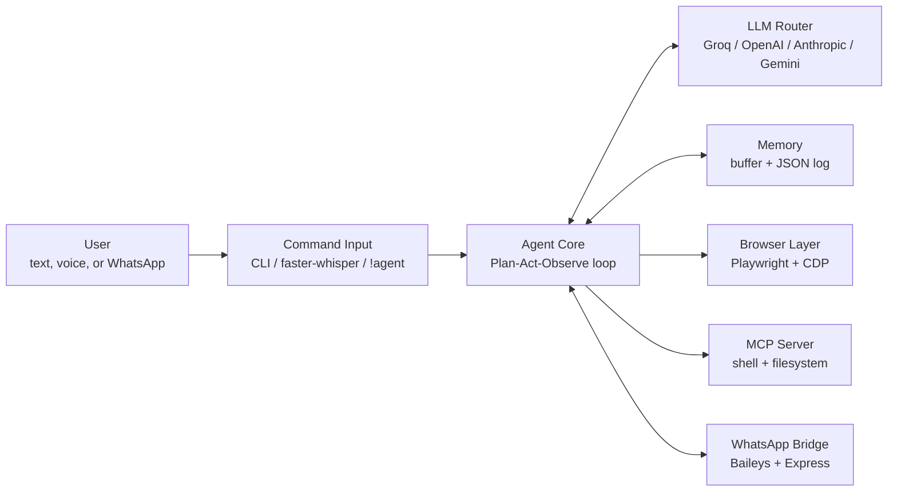

# THING

**An autonomous, terminal-first browser agent that bridges LLM reasoning and real-world web execution.**

THING drives a live Chromium-based browser through the Chrome DevTools Protocol (CDP). It observes the page, plans with an LLM, acts through tool calls, and verifies the result in a continuous loop. Voice input, persistent memory, a WhatsApp bridge, and an MCP server extend it beyond the browser.

---

## Table of Contents

- [Features](#features)
- [Architecture](#architecture)
- [How It Works](#how-it-works)
- [Getting Started](#getting-started)
- [Configuration](#configuration)
- [Usage](#usage)
- [Tool-Calling Protocol](#tool-calling-protocol)
- [Security Model](#security-model)
- [Design Philosophy](#design-philosophy)
- [Known Limitations](#known-limitations)

---

## Features

| Area | Capability |
| :--- | :--- |
| **Web automation** | Controls a live Brave session over CDP (port 9222) using an isolated browser profile, so personal tabs are never touched. |
| **DOM Sniper Injection** | Injects a JavaScript overlay that tags every interactive element with a numeric ID, so the model issues `click(12)` instead of guessing screen coordinates. |
| **Multi-provider routing** | Switch between Groq, OpenAI, Anthropic, and Gemini with a single config change. |
| **Voice commands** | Push-to-talk (CapsLock) with local `faster-whisper` transcription. Speak a task and THING executes it. |
| **Persistent memory** | A short-term execution buffer plus a long-term JSON log of actions, DOM states, and errors, used to avoid repeating failed steps. |
| **MCP server** | Exposes scoped shell and filesystem tools to the agent, gated by human approval for destructive actions. |
| **WhatsApp bridge** | Baileys + Express integration for messaging, alerts, and remote notifications. Also accepts commands over WhatsApp (`!agent <task>`) and replies with live progress. |
| **Cross-platform** | Runtime OS detection resolves browser paths on Linux and Windows. |

---

## Architecture

THING separates the **reasoning layer** (LLM providers) from the **execution layer** (browser, shell, messaging).



### Key Modules

| Path | Responsibility |
| :--- | :--- |
| `config.py` | Provider selection, model names, and UI-noise blacklist. Mirrors `config.example.py`. |
| `core/memory.py` | Short-term buffer and long-term JSON memory logger. |
| `browser/mcp_server.py` | MCP server exposing `execute_shell_command` and `fs_read_write`. |

### Supported Providers

| Provider | Models | Suggested Use |
| :--- | :--- | :--- |
| **Groq** | `llama-3.3-70b-versatile`, `gpt-oss-120b`, `llama-4-scout-17b` | Fast DOM parsing and rapid iterative loops. |
| **OpenAI** | `gpt-4o` | Spatial reasoning and complex JavaScript logic. |
| **Anthropic** | `claude-sonnet-4-6` | Long-context analysis and MCP orchestration. |
| **Gemini** | `gemini-2.0-flash`, `Gemini 3 Flash` | Vision-heavy and multimodal tasks. |

---

## How It Works

THING runs in **Continuous Mode**, an iterative Plan-Act-Observe cycle rather than a single prompt-response exchange.

1. **Observe**: capture the current DOM state and visual viewport.
2. **Plan**: the active LLM compares the current state against the user's objective.
3. **Act**: dispatch a tool call, for example `click(element_id)` or `type(input_id, text)`.
4. **Verify**: the memory observer checks whether the DOM changed as expected. If the agent is stuck in a failure loop, a hard-reset prompt is triggered.

### DOM Sniper Injection

LLMs are unreliable at coordinate-based clicking. THING parses the page with Playwright, strips non-interactive noise, and injects an overlay that labels each interactive element (buttons, inputs, links) with an ID such as `[12]`. The model receives a sanitized map of IDs to element descriptions and responds with an ID, which THING resolves to an exact DOM target:

```python
execute_action("click", {"id": 12})
```

### Browser Initialization

THING launches Brave with remote debugging enabled and attaches over CDP. An isolated `--user-data-dir` avoids port collisions (`Broken pipe 32`) with your primary browsing session.

```python
import platform
import subprocess

def launch_isolated_agent_browser():
    os_name = platform.system()
    if os_name == "Linux":
        brave_path = "brave-browser"
    elif os_name == "Windows":
        brave_path = r"C:\Program Files\BraveSoftware\Brave-Browser\Application\brave.exe"

    command = (
        f'"{brave_path}" --remote-debugging-port=9222 '
        f'--user-data-dir="/tmp/thing-agent-profile"'
    )
    subprocess.Popen(command, shell=True)
```

---

## Getting Started

### Prerequisites

- Python 3.10+
- Brave browser
- Node.js (for the WhatsApp bridge)
- An API key for at least one supported provider

### Installation

```bash
git clone https://github.com/parth8454/THING-V1.git
cd THING-V1

python -m venv .venv
source .venv/bin/activate        # Windows: .\.venv\Scripts\activate.bat

pip install -r requirements.txt
playwright install
```

### Configuration

Never hardcode API keys. Copy the example config and store secrets in a `.env` file.

```bash
cp config.example.py config.py
```

```env
# .env
GROQ_API_KEY=your_key_here
OPENAI_API_KEY=your_key_here
ANTHROPIC_API_KEY=your_key_here
GEMINI_API_KEY=your_key_here
```

```python
# config.py
MODELS_LIST = ["groq", "openai", "anthropic", "gemini"]
PROVIDER = MODELS_LIST[0]

TEXT_MODEL = "openai/gpt-oss-120b"
VISION_MODEL = "meta-llama/llama-4-scout-17b-16e-instruct"
UI_NOISE_BLACKLIST = ["close", "dismiss", "cookie"]
```

To switch providers, change `PROVIDER`. This is useful when you hit a rate limit.

---

## Usage

```bash
python main.py
```

Enter a task at the prompt, or speak it if voice input is enabled.

```text
> Open YouTube and play a lofi stream
```

### Commands over WhatsApp

THING can also be controlled remotely through the WhatsApp bridge. Any message that starts with `!agent` is treated as a command. You can send commands by messaging your own WhatsApp number, and the agent replies with its current progress as it works.

```text
!agent open YouTube and play a lofi stream
```

Messages that do not start with `!agent` are ignored.

---

## Tool-Calling Protocol

Native function calling can be unreliable on some models (for example `llama-3.3-70b-versatile`), so THING uses a two-layer protocol:

1. **Native API mode**: standard function-calling definitions via the provider SDK.
2. **Regex fallback mode**: if native parsing fails, THING injects a system prompt that requires a strict XML schema, which the backend parses directly:

   ```xml
   <action>NAME</action><id>VALUE</id>
   ```

---

## Security Model

The MCP server gives the agent scoped access to the host machine:

- **`execute_shell_command`**: runs bash, zsh, or PowerShell commands with strict timeouts.
- **`fs_read_write`**: reads local codebases and writes code to them.
- **Human-in-the-loop approval**: destructive operations (for example `rm` or package installs) require an explicit `[y/N]` confirmation in the terminal before they run.

Because the agent can execute commands on your machine, run it only with models and prompts you trust, and review every approval prompt.

---

## Design Philosophy

THING is terminal-first by design.

- **Low overhead**: no frontend stack, websockets, or rendering cost. Resources go to DOM processing and LLM context management.
- **Speed**: voice or text in, execution out, with no dashboard in between.
- **Transparency**: the terminal shows raw API payloads, memory state changes, and tracebacks in real time.
- **Proximity to the OS**: running outside a browser sandbox lays the groundwork for local script execution.

It is a developer tool rather than a consumer product.

---

## Known Limitations

| Limitation | Detail |
| :--- | :--- |
| **Canvas / WebGL / Shadow DOM** | Sites that render UI in `<canvas>`, WebGL (for example Spline scenes or browser games), or obfuscated Shadow DOMs expose no standard elements to tag, so the agent cannot reliably interact with them. |
| **Token cost and rate limits** | Each action re-reads the updated DOM. This consumes tokens quickly on paid models, and free tiers (for example Groq) can hit RPM or TPM limits within minutes of aggressive looping. |
| **Latency** | Each step runs scrape, API call, inference, parse, and execute, adding roughly 2 to 5 seconds per action. This is slower than a hardcoded Playwright or Selenium script. |
| **Setup complexity** | Requires comfort with Git, Python virtual environments, `playwright install`, and `.env` management. |
| **Popups and obstructions** | Cookie banners, newsletter modals, and CAPTCHAs can obscure target elements. Memory reduces repeated failures but does not eliminate loops unless the model reasons to dismiss the obstruction first. |

---

## Contributing

Issues and pull requests are welcome. Please open an issue to discuss significant changes before submitting a PR.
